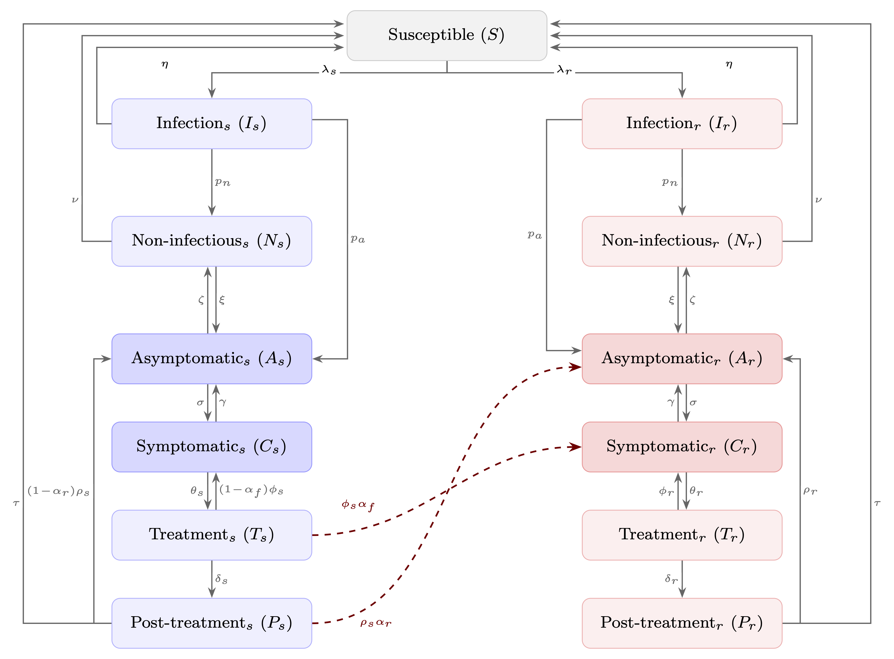

# Two-Strain DS/RR-TB Transmission Model for Viet Nam

## Overview

This pipeline implements a deterministic compartmental model of drug-susceptible (DS) and rifampicin-resistant (RR) TB transmission in Viet Nam. The model is calibrated to WHO incidence estimates and used to project the impact of isoniazid-resistance (INH-R) diagnosis and treatment interventions on RR-TB burden.

The central hypothesis is that a substantial fraction of RR-TB in Viet Nam arises through acquired resistance during treatment of DS-TB patients who have undetected INH-R, and that diagnosing and appropriately treating INH-R can reduce the rate of resistance acquisition, thereby reducing RR-TB incidence.

## Model Structure

The model tracks two strains (DS and RR) across 13 compartments (1 shared Susceptible + 6 per strain):

| Symbol | Compartment | Description |
|---|---|---|
| S | Susceptible | No bacilli, no pathology, no symptoms, not infectious |
| I_x | Infection | Bacilli present, no pathology, no symptoms, not infectious |
| N_x | Non-infectious | Bacilli present, pathology present, no symptoms, not infectious |
| A_x | Asymptomatic | Bacilli present, pathology present, no symptoms, infectious (reduced) |
| C_x | Symptomatic | Bacilli present, pathology present, symptoms, infectious |
| T_x | Treatment | On anti-TB therapy |
| P_x | Post-treatment | Treatment completed |

where subscript x ∈ {s, r} denotes the drug-susceptible and rifampicin-resistant strain, respectively.

### Key Dynamics

**Transmission.** Force of infection is strain-specific. RR-TB transmissibility is scaled by a fitness parameter (f, range 0.3–1.0). Asymptomatic individuals transmit at a reduced rate (κ relative to symptomatic).

**Natural history.** After infection, individuals progress with three possible outcomes: clearance back to Susceptible (→ S at rate η), non-infectious disease (→ N at rate p_n), or asymptomatic disease (→ A at rate p_a). Non-infectious individuals can recover back to Susceptible (→ S at rate ν) or progress to asymptomatic disease (→ A at rate ξ). Bidirectional transitions occur between Non-infectious and Asymptomatic (rates ξ, ζ) and between Asymptomatic and Symptomatic (rates σ, γ). Symptomatic individuals can regress to asymptomatic (γ), die from TB (d), or be diagnosed and started on treatment (θ).

**Treatment (delay differential equations).** Treatment completion uses fixed-delay DDEs rather than exponential rates. Individuals who enter treatment at time t − Δ complete at time t, attenuated by background mortality during treatment (e^{−μΔ}). DS-TB treatment duration is fixed at Δ_s = 0.5 years (6 months). RR-TB treatment duration Δ_r transitions from 1.5 years (18-month regimen) to 0.5 years (6-month BPaL) over 2020–2024.

**Resistance acquisition.** DS-TB treatment has two pathways to generate RR-TB:

1. **Treatment failure** — A fraction α_f of DS-TB treatment failures acquire rifampicin resistance, entering C_r (Symptomatic RR-TB) instead of returning to C_s (Symptomatic DS-TB).
2. **Post-treatment relapse** — A fraction α_r of DS-TB relapses acquire resistance, entering A_r (Asymptomatic RR-TB). Relapses without resistance return to A_s (Asymptomatic DS-TB).

These are the flows targeted by the INH-R intervention.

**Post-treatment → Susceptible.** After treatment completion, individuals return to the Susceptible pool at rate τ. While in the Post-treatment compartment they can also relapse (at rate ρ_s or ρ_r), returning to the Asymptomatic stage.

**Demography.** Background mortality (μ = 0.013/yr) applies to all compartments. TB-specific mortality (d_s, d_r) applies to the Symptomatic compartment only. Both background and TB-specific deaths are replaced by births into the Susceptible compartment, maintaining a closed population of N = 100,000.

### Time-Varying Parameters

Six parameters are modelled as linear forcing functions interpolating from an initial value (constant 1500–1999) to a final value (2024), reflecting improvements in TB control over time:

| Parameter | Description | DS | RR |
|---|---|---|---|
| θ (theta) | Diagnosis rate | θ_s,0 → θ_s,1 | θ_r,0 → θ_r,1 |
| φ (phi) | Treatment failure rate | φ_s,0 → φ_s,1 | φ_r,0 → φ_r,1 |
| d | TB-specific mortality | d_s,0 → d_s,1 | d_r,0 → d_r,1 |

Additionally, Δ_r (RR-TB treatment duration) transitions from 1.5 years (18-month regimen) to 0.5 years (6-month BPaL) linearly over 2020–2024.

### Fixed Parameters

| Parameter | Value | Justification |
|---|---|---|
| N | 100,000 | Per 100k scaling |
| μ (background mortality) | 0.013/yr | 75-year life expectancy |
| Δ_s (DS treatment duration) | 0.5 years | 6-month standard regimen |

## Calibration

The model is calibrated using History Matching with Emulation (HMER), an iterative approach that uses Gaussian process emulators to efficiently identify parameter sets consistent with observed data, without requiring a likelihood function.

The model is initialised in 1500 and run forward with constant parameters until 1999 to ensure the epidemic reaches endemic equilibrium before the care cascade transition begins.

### Calibration Targets

| Target | Years | Source |
|---|---|---|
| Total TB incidence (per 100k) | 2000, 2005, 2010, 2015, 2019, 2023, 2024 | WHO GTB estimates (with uncertainty bounds) |
| RR-TB incidence (per 100k) | 2015, 2017, 2019, 2023, 2024 | WHO GTB estimates |
| Proportion of RR-TB that is acquired | 2024 | 13–28% (from our genomic analysis) |

COVID years (2020–2022) are excluded from calibration.

### Calibration Process

1. **Wave 1** (`02_Fit_DDE.R`): Generate 560 initial parameter sets via maximin Latin Hypercube Sampling across the 28-dimensional parameter space. Run each through the DDE model and evaluate against targets. Train Gaussian process emulators on the input-output relationship.
2. **Iterative waves** (`02b_Fit_Waves_DDE.R`): Use emulators to identify non-implausible regions of parameter space. Generate new candidate points in these regions, run the full model, retrain emulators, and repeat. A stationarity analysis confirmed that median intervention impact estimates had stabilised.

### Parameters Calibrated (28 total)

| Category | Parameters |
|---|---|
| Transmission | β, κ, f |
| Natural history | η, p_n, p_a, ν, ξ, ζ, σ, γ |
| DS-TB care cascade (time-varying) | θ_s,0/1, φ_s,0/1, d_s,0/1 |
| RR-TB care cascade (time-varying) | θ_r,0/1, φ_r,0/1, d_r,0/1 |
| Post-treatment | τ, ρ_s, ρ_r |
| Resistance acquisition | α_f, α_r |

## Intervention Scenarios

Interventions are modelled by reducing the resistance acquisition rates (α_f and α_r) by a factor of (1 − coverage × efficacy × PAF), where:

- **Coverage**: proportion of DS-TB patients receiving INH-R testing
- **Efficacy**: fixed at 97.5%, corresponding to the estimated efficacy of the WHO-recommended HR-TB regimen
- **PAF**: population attributable fraction for acquired RR-TB due to INH-R (0.869–0.981, from our case-control analysis)

Coverage and PAF are sampled from uniform distributions per model run, propagating uncertainty.

| Scenario | Coverage | Efficacy |
|---|---|---|
| Baseline | 0% | — |
| Low (20%) | 15–25% | 97.5% |
| Medium (50%) | 40–60% | 97.5% |
| High (80%) | 70–90% | 97.5% |
| Universal DST (100%) | 95–100% | 97.5% |

Interventions begin in 2025 and the model projects forward to 2035.

## Sensitivity Analysis

To approximate the potential impact across settings with different INH-R prevalence or acquired resistance dynamics, the PAF is recalculated using Levin's formula across nine scenarios defined by three levels of INH-R prevalence (5%, 10%, 20%) and three levels of relative risk (observed RR = 105, 2-fold lower, 5-fold lower). The universal coverage intervention is re-run under each scenario.

---

## Script Descriptions

### `01_Data.R` — Data Preparation

Loads WHO incidence data for Viet Nam and constructs calibration targets.

**Inputs:** `data/who/vnm_data.xlsx`

**Outputs:** `data/fit/targets.Rdata`, `data/fit/targets_list.Rdata`, `data/fit/research_params.Rdata`

---

### `02_Fit_DDE.R` — Model Definition & Initial Calibration Wave

Defines the two-strain DDE model with fixed-delay treatment completion and runs the first wave of history matching.

**Outputs:** `outputs/waves/w001_wave.Rdata`, `outputs/ems/w001_ems.Rdata`, `outputs/pts/w001_pts.Rdata`

---

### `02b_Fit_Waves_DDE.R` — Iterative Calibration

Continues HMER waves until plausible parameter sets are found. Uses recent emulators (last 15 waves) for point generation to avoid computational bottleneck from stacking all waves.

**Outputs:** `outputs/pts/fitpts.Rdata` (main calibration output)

---

### `03_FitPlots_DDE.R` — Calibration Diagnostics

Runs all plausible parameter sets through the DDE model and generates calibration diagnostic plots.

**Outputs:** `outputs/results.Rdata`, `plots/01_calibration_fit.pdf`, `plots/03_parameters.pdf`

---

### `04_Scenarios_DDE.R` — Intervention Projections

Projects model forward under baseline and four INH-R intervention scenarios. Model outputs at 0.1-year resolution from 2020–2035 for smooth plotting.

**Outputs:** `outputs/results/scenarios_summary.Rdata`, `outputs/results/impact_summary.Rdata`

---

### `04b_Sensitivity_DDE.R` — PAF Sensitivity Analysis

Runs the universal coverage intervention across nine PAF scenarios (3 INH-R prevalence levels × 3 RR levels) using Levin's formula. Generates the sensitivity forest plot.

**Outputs:** `outputs/results/sensitivity/sens_impact.Rdata`, `plots/sensitivity_forest.pdf`

---

### `05_Results.R` — Results Processing

Computes cumulative impact metrics over 2025–2035 and scales to national population.

**Outputs:** `outputs/outs/results_table.Rdata`

---

### `06_Plots.R` — Figures

Generates the main two-panel figure (RR-TB incidence trajectory + forest plot of reduction by coverage).

**Outputs:** `plots/main_figure.pdf`
