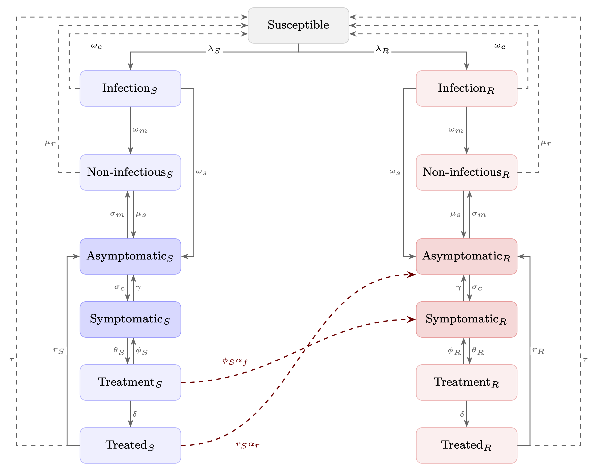

# Two-Strain DS/RR-TB Transmission Model for Vietnam

## Overview

This pipeline implements a deterministic compartmental model of drug-susceptible (DS) and rifampicin-resistant (RR) TB transmission in Viet Nam. The model is calibrated to WHO incidence estimates and used to project the impact of isoniazid-resistance (INH-R) diagnosis and treatment interventions on RR-TB burden.

The central hypothesis is that a substantial fraction of RR-TB in Vietnam arises through acquired resistance during treatment of DS-TB patients who have undetected INH-R, and that diagnosing and appropriately treating INH-R can reduce the rate of resistance acquisition, thereby reducing RR-TB incidence.

## Model Structure

The model tracks two strains (DS and RR) across 13 compartments (1 shared Susceptible + 6 per strain):

| Compartment | Description |
|---|---|
| **Susceptible/SUS** | No bacili, no pathology, no symptoms, not infectious |
| **Infection/INF** | Bacili present, no pathology, no symptoms, not infectious |
| **Non-infectious/MIN** | Bacili present, pathology present, no symptoms, not infectious |
| **Asymptomatic/SUB** | Bacili present, pathology present, no symptoms, infectious|
| **Symptomatic/CLN** | Bacili present, pathology present, symptoms, infectious |
| **Treatment/TXT** | On treatment |
| **Treated/TRE** | Treatment completed |

Each compartment except SUS is duplicated for DS and RR strains (e.g. `SUB_DS`, `SUB_RR`).

### Key Dynamics

**Transmission.** Force of infection is strain-specific. RR-TB transmissibility is scaled by a fitness parameter (`fitness_rr`, range 0.3–1.0). Subclinical individuals transmit at a reduced rate (κ relative to symptomatic).

**Natural history.** After infection, individuals progress with three possible outcomes: clearance back to Susceptible (→ SUS at rate ω_c), non-infectious disease (→ MIN at rate ω_m), or asymptomatic disease (→ SUB at rate ω_s). Non-infectious individuals can recover back to Susceptible (→ SUS at rate μ_r) or progress to asymptomatic disease (→ SUB at rate μ_s). Asymptomatic disease cases can regress to non-infectious or progress to symptomatic disease. Symptomatic disease cases can regress to subclinical (γ), die from TB, or be diagnosed and started on treatment.

**Treatment and resistance acquisition.** DS-TB treatment has two pathways to generate RR-TB:

1. **Treatment failure** — A fraction `acq_fail` of DS-TB treatment failures acquire rifampicin resistance, entering CLN_RR (Symptomatic RR-TB) instead of returning to CLN_DS (Symptomatic DS-TB).
2. **Post-treatment relapse** — A fraction `acq_relapse` of DS-TB relapses acquire resistance, entering SUB_RR (Asymptomatic RR-TB). Relapses without resistance return to SUB_DS (Asymptomatic DS-TB).

These are the flows targeted by the INH-R intervention.

**Treated → Susceptible.** After treatment completion, individuals return to the Susceptible pool at rate τ. While in the Treated compartment they can also relapse (at rate `relapse_ds` or `relapse_rr`), returning to the Asymptomatic stage.

### Time-Varying Parameters

Six parameters are modelled as linear forcing functions interpolating from an initial value (pre-2000) to a final value (2024), reflecting improvements in TB control over time:

| Parameter | Description | DS | RR |
|---|---|---|---|
| θ (theta) | Diagnosis rate | θ_ds_ini → θ_ds_fin | θ_rr_ini → θ_rr_fin |
| φ (phi) | Treatment failure rate | φ_ds_ini → φ_ds_fin | φ_rr_ini → φ_rr_fin |
| μ_tb (mutb) | TB-specific mortality | mutb_ds_ini → mutb_ds_fin | mutb_rr_ini → mutb_rr_fin |

Additionally, `delta_rr` (RR-TB treatment completion rate) transitions from 0.67/yr (18-month regimen) to 2.0/yr (6-month BPaL) linearly over 2020–2024.

### Fixed Parameters

| Parameter | Value | Justification |
|---|---|---|
| N | 100,000 | Per 100k scaling |
| μ (background mortality) | 0.013/yr | 75-year life expectancy |
| δ_ds (DS treatment completion) | 2/yr | 6-month standard regimen |

## Calibration

The model is calibrated using History Matching with Emulation (HMER), an iterative approach that user emulators to efficiently identify parameter sets consistent with observed data, without requiring a likelihood function.

### Calibration Targets

| Target | Years | Source |
|---|---|---|
| Total TB incidence (per 100k) | 2000, 2005, 2010, 2015, 2019, 2023, 2024 | WHO GTB estimates (with uncertainty bounds) |
| RR-TB incidence (per 100k) | 2015, 2017, 2019, 2023, 2024 | WHO GTB estimates |
| Proportion of RR-TB that is acquired | 2024 | 13–28% (from our genomic analysis) |

COVID years (2020–2022) are excluded from calibration.

### Calibration Process

1. **Wave 1** (`02_Fit.R`): Generate 560 initial parameter sets via maximin Latin Hypercube Sampling across the 28-dimensional parameter space. Run each through the ODE model and evaluate against targets. Train Gaussian process emulators on the input-output relationship.
2. **Iterative waves** (`02b_Fit_Waves.R`): Use emulators to identify non-implausible regions of parameter space (regions where the emulator predicts outputs consistent with targets). Generate new candidate points in these regions, run the full model, retrain emulators, and repeat. Waves continue until 1,000 unique parameter sets are found that simultaneously satisfy all calibration targets.

The emulator training includes diagnostic checks: sigma inflation for misclassified points and removal of emulators that fail comparison diagnostics. Wave 2 onward runs in parallel across available cores.

### Parameters Calibrated (28 total)

| Category | Parameters |
|---|---|
| Transmission | `beta`, `kappa`, `fitness_rr` |
| Natural history | `omega_c`, `omega_m`, `omega_s`, `mu_r`, `mu_s`, `sigma_m`, `sigma_c`, `gamma` |
| DS-TB care cascade (time-varying) | `theta_ds_ini/fin`, `phi_ds_ini/fin`, `mutb_ds_ini/fin` |
| RR-TB care cascade (time-varying) | `theta_rr_ini/fin`, `phi_rr_ini/fin`, `mutb_rr_ini/fin` |
| Post-treatment | `tau`, `relapse_ds`, `relapse_rr` |
| Resistance acquisition | `acq_fail`, `acq_relapse` |

## Intervention Scenarios

Interventions are modelled by reducing the resistance acquisition rates (`acq_fail` and `acq_relapse`) by a factor of `(1 − coverage × efficacy × PAF)`, where:

- **Coverage**: proportion of DS-TB patients receiving INH-R testing
- **Efficacy**: probability that testing leads to appropriate treatment modification
- **PAF**: population attributable fraction for acquired RR-TB due to INH-R (0.856–0.981, from our case-control analysis)

All three are sampled from uniform distributions per model run, propagating uncertainty.

| Scenario | Coverage | Efficacy |
|---|---|---|
| Baseline | 0% | — |
| Low (20%) | 15–25% | 70–90% |
| Medium (50%) | 40–60% | 70–90% |
| High (80%) | 70–90% | 70–90% |
| Universal DST (100%) | 95–100% | 85–95% |

Interventions begin in 2025 and the model projects forward to 2035.

---

## Script Descriptions

### `01_Data.R` — Data Preparation

**Purpose:** Load WHO incidence data for Vietnam and construct calibration targets.

**Inputs:**
- `data/who/vnm_data.xlsx` — WHO Global TB Report estimates for Vietnam (incidence, RR-TB cases, population)

**What it does:**

1. Creates the project directory structure (`data/`, `outputs/`, `plots/` and subdirectories).
2. Reads the WHO data file and computes RR-TB incidence rates per 100k from case counts and population.
3. Constructs calibration targets as named lists of `[lo, hi]` bounds:
   - 7 total TB incidence targets (2000–2024, excluding COVID years) from WHO uncertainty intervals
   - 5 RR-TB incidence targets (2015–2024) from WHO uncertainty intervals
   - 1 acquired resistance proportion target for 2024: **13–28%** (from our genomic epidemiology analysis)
4. Saves targets in two formats: a data.frame for HMER (`targets.Rdata`) and a named list (`targets_list.Rdata`).
5. Stores the PAF estimate (0.951, 95% CI: 0.856–0.981) and proportion acquired estimate (0.205, range: 0.13–0.28) for downstream use.

**Outputs:**
- `data/who/who_data_processed.Rdata`
- `data/fit/targets.Rdata`, `data/fit/targets_list.Rdata`
- `data/fit/research_params.Rdata`

---

### `02_Fit.R` — Model Definition & Initial Calibration Wave

**Purpose:** Define the two-strain ODE model and run the first wave of history matching.

**What it does:**

1. **Defines baseline parameter values and calibration ranges** for all 28 parameters. Ranges are sourced from the Parameters.docx (literature-derived bounds).
2. **Implements the ODE system** (`ode_2strain` function):
   - Creates time-varying forcing functions for all 6 time-varying parameters using `approxfun` with a helper `make_forcer()` function. Each interpolates linearly from the initial value (constant 1900–1999) to the final value (at 2024).
   - Defines the differential equations for all 13 compartments.
   - Computes derived outputs: incidence (total, RR, acquired/transmitted), proportion acquired, proportion RR, prevalence, mortality, and notifications — all per 100k.
3. **Runs a test simulation** with baseline parameters and prints 2020–2024 outputs as a sanity check.
4. **Sets up HMER infrastructure:**
   - `hmer_res()` — wrapper that runs the model and extracts outputs at calibration time points in the format HMER expects.
   - `target_check()` — counts how many targets each run satisfies.
   - `target_subset()` — filters to runs meeting all (or all minus `sens`) targets.
5. **Generates initial parameter sets** via two maximin Latin Hypercube designs (2 × 10p = 560 points for p = 28 parameters), evaluates each through the full model, and records results.
6. **Trains Gaussian process emulators** on the Wave 1 results using a 50/50 train/validation split. Performs diagnostic checks (sigma inflation for misclassification, removal of poorly performing emulators).
7. **Generates candidate points** for Wave 2 using `generate_new_design()` from HMER.

**Outputs:**
- `outputs/waves/w001_wave.Rdata` — Wave 1 parameter sets + model outputs
- `outputs/wave_res/w001_waveres.Rdata` — Wave 1 model outputs only
- `outputs/ems/w001_ems.Rdata` — Trained emulators
- `outputs/pts/w001_pts.Rdata` — Candidate points for next wave

---

### `02b_Fit_Waves.R` — Iterative Calibration

**Purpose:** Continue HMER waves from where `02_Fit.R` left off until 1,000 plausible parameter sets are found.

**What it does:**

1. Sets up parallel processing using all available cores minus one.
2. Loads all existing wave results, emulators, and candidate points to determine where to resume.
3. Collects any existing plausible points (sets that already satisfy all targets).
4. Runs an iterative loop:
   - Evaluates candidate parameter sets through the full ODE model (in parallel).
   - Checks how many satisfy all calibration targets.
   - Accumulates plausible sets across all waves.
   - If < 1,000 plausible sets: trains new emulators on the latest wave, stacks them with all prior emulators for increasingly refined space reduction, and generates new candidate points.
   - Stops when 1,000 unique plausible parameter sets are reached.
5. Handles edge cases: if a wave produces too few successful runs for emulator training, it perturbs the previous candidate set with small random noise and retries.

**Outputs:**
- `outputs/pts/fitpts.Rdata` — Final set of ≥1,000 plausible parameter sets (the main calibration output used by all downstream scripts)
- `outputs/waves/w{NNN}_wave.Rdata` — Per-wave results
- `outputs/ems/w{NNN}_ems.Rdata` — Per-wave emulators

---

### `03_FitPlots.R` — Calibration Diagnostics

**Purpose:** Validate the calibration by running all plausible parameter sets through the model and comparing outputs to targets.

**What it does:**

1. Loads the plausible parameter sets from `fitpts.Rdata`.
2. Runs each through the ODE model from 1900–2024.
3. Computes quantile envelopes (2.5th, 25th, 50th, 75th, 97.5th percentiles) for each output variable across all runs.
4. Generates a 4-panel calibration figure:
   - **A. Total TB incidence**
   - **B. RR-TB incidence**
   - **C. Proportion of RR-TB acquired**
   - **D. RR proportion of all TB**
5. Generates a histogram panel showing posterior distributions of key parameters (β, fitness_rr, acq_fail, acq_relapse, θ_ds_fin, θ_rr_fin).
6. Prints a summary table of median (95% CI) for each output at 2024.

**Outputs:**
- `outputs/results.Rdata`
- `plots/01_calibration_fit.png`
- `plots/03_parameters.png`

---

### `04_Scenarios.R` — Intervention Projections

**Purpose:** Project model forward under baseline and four INH-R intervention scenarios to estimate impact on RR-TB.

**What it does:**

1. Loads the plausible parameter sets.
2. Defines 5 scenarios (baseline + 4 intervention levels) with uncertainty ranges on coverage and efficacy.
3. For each scenario × parameter set combination:
   - Samples coverage, efficacy, and PAF from their uncertainty distributions.
   - Computes the intervention effect: `1 − coverage × efficacy × PAF`.
   - Runs the model from 1900–2035. Before 2025 the model is identical to baseline; from 2025 onward, `acq_fail` and `acq_relapse` are multiplied by the intervention effect.
4. Computes quantile summaries for all output variables by scenario and year.
5. Calculates impact metrics at 2035 (relative to baseline): percent reduction in RR-TB incidence, percent reduction in acquired RR-TB, cases averted per 100k.
6. Prints an impact summary table.

**Outputs:**
- `outputs/results/scenarios_raw.Rdata`
- `outputs/results/scenarios_summary.Rdata`
- `outputs/results/impact_raw.Rdata`
- `outputs/results/impact_summary.Rdata`

**Design note:** The intervention does not affect RR-TB transmission or treatment — it only reduces the *de novo* generation of new RR-TB through resistance acquisition. This is conservative, since improved INH-R management could also improve DS-TB treatment outcomes more broadly.

---

### `05_Results.R` — Results Processing

**Purpose:** Compute cumulative impact metrics over the 2025–2035 projection period and produce summary tables.

**What it does:**

1. Loads raw scenario results and impact summaries from `04_Scenarios.R`.
2. Computes cumulative metrics per run: total RR-TB incidence-years, total acquired RR-TB, total RR-TB mortality over 2025–2035.
3. Compares each intervention scenario to baseline: cumulative cases averted, cumulative deaths averted, percent reductions.
4. Produces a summary table with median (95% CI) for all metrics.
5. Scales results to Vietnam's national population (~100 million) to report absolute numbers of cases and deaths averted.

**Outputs:**
- `outputs/outs/cumulative.Rdata`
- `outputs/outs/comparisons.Rdata`
- `outputs/outs/results_table.Rdata`
- `outputs/outs/baseline_summary.Rdata` 

---

### `06_Plots.R`

**Purpose:** Generate figures for the intervention analysis.

**What it does:**

1. Loads scenario summaries and impact metrics.
2. Produces a 4-panel combined figure:
   - **A. RR-TB incidence over time (2020–2035)**
   - **B. Proportion of RR-TB acquired over time** 
   - **C. Impact bar chart** 
   - **D. Remaining RR-TB burden** 

**Outputs:**
- `plots/combined_figure.png` 
- `plots/panel_p1.png` through `plots/panel_p4.png`

---
